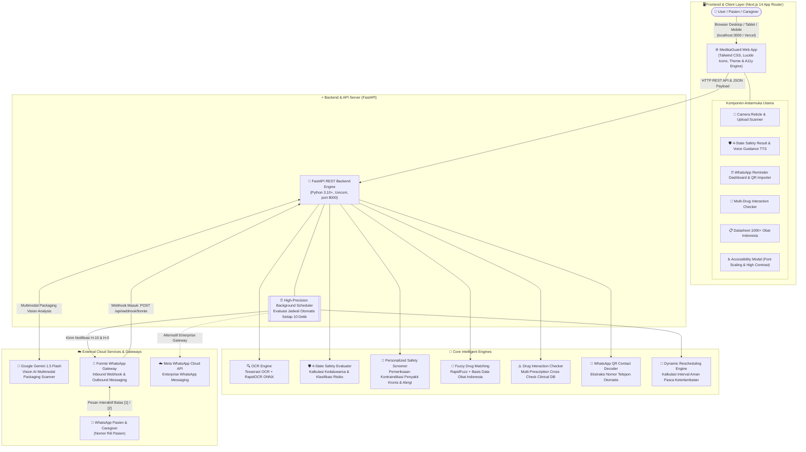
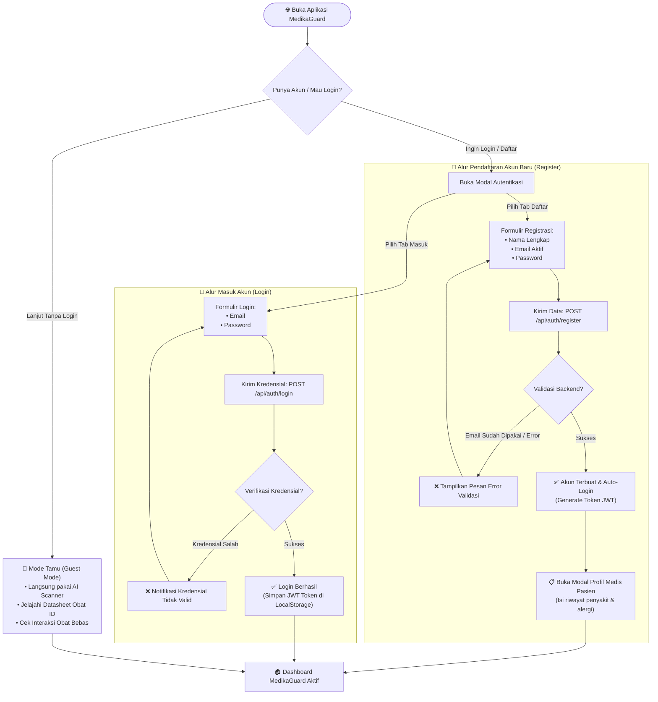
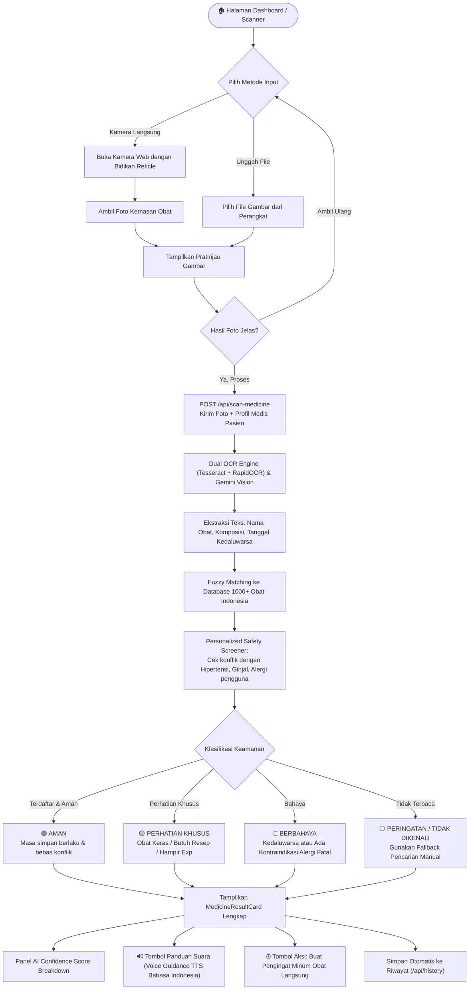
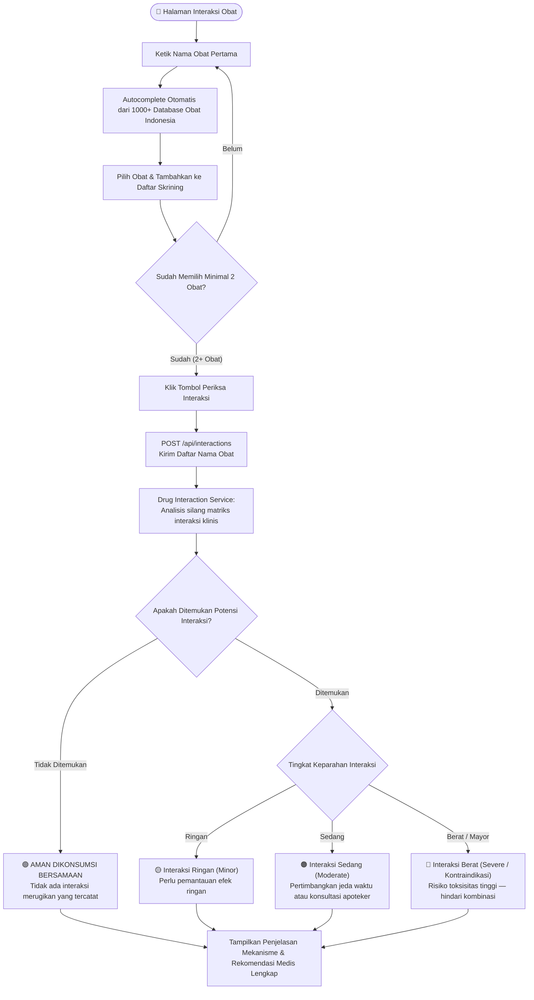
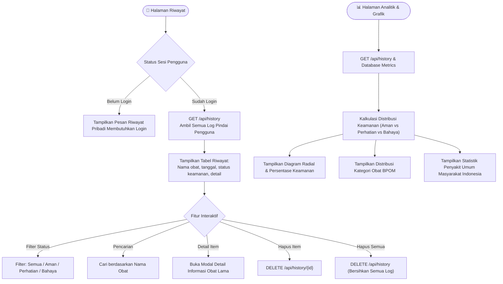
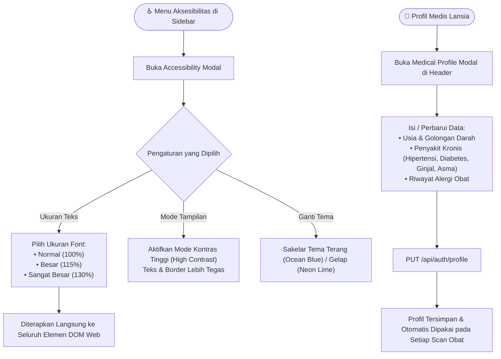

## 👥 Tim Pengembang

### **VectorX**
- **Muhammad Umar Fathullah**
- **Athaillah Ramadhan**
- **Rifqi Aunur Rahman**
- **Rafif Khairi Andriadel**

---

## 🤖 Sumber AI yang Digunakan

### Daftar Sumber AI yang Digunakan dari Gemini:

- https://share.gemini.google/zOKH71ntIyqk
- https://share.gemini.google/75R260X3kKGg
- https://share.gemini.google/hehNQnQPTGdb
- https://share.gemini.google/rjnfcS4rtuX9
- https://share.gemini.google/CxswWaZzA5R8
- https://share.gemini.google/CJGpf3LYLycY
- https://share.gemini.google/FTfN7f5LyiPz

> [!NOTE]  
> **Catatan:** Beberapa prompt juga dijalankan menggunakan platform Antigravity, namun riwayat percakapan tidak dapat diekstrak/diambil.

---

<div align="center">


# 🛡️ MedikaGuard (PharmaShield ID)

**Sistem Keamanan Konsumsi & Pengingat Obat Berbasis AI untuk Pasien & Lansia**

[](https://fastapi.tiangolo.com)
[](https://nextjs.org)
[](https://python.org)
[](https://aistudio.google.com)
[](https://fonnte.com)
[](LICENSE)

</div>

---

## 📋 Daftar Isi

- [Tim Pengembang](#-tim-pengembang)
- [Sumber AI yang Digunakan](#-sumber-ai-yang-digunakan)
- [Tentang Project](#-tentang-project)
- [Fitur Utama Website](#-fitur-utama-website)
- [Arsitektur Sistem](#-arsitektur-sistem)
- [User Flow](#-user-flow)
  - [Flow 1 — Autentikasi & Mode Tamu](#flow-1--autentikasi--mode-tamu)
  - [Flow 2 — Scan Kemasan Obat & Evaluasi Keamanan](#flow-2--scan-kemasan-obat--evaluasi-keamanan)
  - [Flow 3 — Pengingat Minum Obat WhatsApp & Smart Timeline](#flow-3--pengingat-minum-obat-whatsapp--smart-timeline)
  - [Flow 4 — Cek Interaksi Obat](#flow-4--cek-interaksi-obat)
  - [Flow 5 — Riwayat Pindai & Analitik](#flow-5--riwayat-pindai--analitik)
  - [Flow 6 — Pusat Aksesibilitas & Profil Medis Lansia](#flow-6--pusat-aksesibilitas--profil-medis-lansia)
  - [State Machine Reminder Engine](#state-machine-reminder-engine)
- [Struktur Project](#-struktur-project)
- [Tech Stack](#-tech-stack)
- [Prasyarat](#-prasyarat)
- [Cara Menjalankan Lokal (Step by Step)](#-cara-menjalankan-lokal-step-by-step)
  - [1. Clone Repository](#1-clone-repository)
  - [2. Setup Backend (FastAPI)](#2-setup-backend-fastapi)
  - [3. Setup Frontend (Next.js)](#3-setup-frontend-nextjs)
  - [4. Jalankan Aplikasi](#4-jalankan-aplikasi)
  - [5. Verifikasi Berjalan](#5-verifikasi-berjalan)
- [Environment Variables Lengkap](#-environment-variables-lengkap)
- [Menjalankan dengan Docker](#-menjalankan-dengan-docker)
- [API Endpoints](#-api-endpoints)
- [WhatsApp Gateway & Notifikasi](#-whatsapp-gateway--notifikasi)
- [Deployment (Railway + Vercel)](#-deployment-railway--vercel)
- [Testing](#-testing)
- [Troubleshooting](#-troubleshooting)
- [Kontribusi](#-kontribusi)
- [Lisensi](#-lisensi)
- [Link Penting](#-link-penting)

---

## 🎯 Tentang Project

**MedikaGuard** (dikenal juga sebagai **PharmaShield ID**) adalah platform kesehatan digital yang dirancang khusus untuk mempermudah pasien, keluarga, dan lansia dalam memastikan keamanan serta ketepatan konsumsi obat-obatan sehari-hari.

Aplikasi web ini berfokus pada fitur-fitur nyata yang telah diimplementasikan:

1. **📸 AI Vision Scanner & OCR Kemasan Obat** — Mengidentifikasi nama obat, tanggal kedaluwarsa, sisa masa simpan, dan klasifikasi keamanan secara otomatis melalui kamera atau unggahan foto.
2. **🛡️ 4-State Safety Grading & Panel Transparansi AI** — Evaluasi keamanan 4 status (Aman, Perhatian Khusus, Bahaya, dan Peringatan) dilengkapi rincian skor keyakinan AI (*Confidence Score*).
3. **👤 Profil Medis Lansia & Personalized Safety Screening** — Skrining otomatis riwayat penyakit kronis (Hipertensi, Diabetes, Ginjal, Asma) dan riwayat alergi obat pasien saat memindai obat.
4. **🔊 Voice Guidance & Fitur Aksesibilitas Khusus Lansia** — Panduan suara (Text-to-Speech) dalam Bahasa Indonesia, kontrol ukuran teks fleksibel, serta Mode Kontras Tinggi (*High Contrast Mode*).
5. **⏰ Pengingat Minum Obat WhatsApp & Smart Timeline** — Notifikasi otomatis multi-tahap (Konfirmasi Awal, Pra-minum H-10 Menit, dan Aksi Waktu H Interaktif) dengan *Dynamic Rescheduling Engine* saat terlambat minum.
6. **📱 Pindai QR Kontak WhatsApp** — Kemudahan mendaftarkan nomor telepon pasien cukup dengan mengunggah tangkapan layar kode QR kontak WhatsApp.
7. **💊 Cek Interaksi Antar-Obat** — Pemeriksaan kombinasi obat multipel secara simultan untuk mendeteksi potensi interaksi berbahaya.
8. **📋 Datasheet 1000+ Obat Indonesia** — Katalog lengkap obat-obatan penyakit umum Indonesia terintegrasi data resmi BPOM dan Alodokter.
9. **📊 Riwayat Pindai & Analitik Visual** — Pencatatan histori pemindaian dan visualisasi diagram status keselamatan obat.

---

## ✨ Fitur Utama Website

Berikut adalah daftar fitur yang **aktif dan tersedia langsung pada website MedikaGuard**:

| Fitur | Deskripsi | Status di Website |
|---|---|:---:|
| 📸 **AI Vision Scanner & OCR** | Pindai kemasan obat via kamera langsung (dengan *reticle guide*) atau unggah file. Ekstraksi nama, tanggal kedaluwarsa, dan status registrasi BPOM. | ✅ Ada (`/`) |
| 🛡️ **4-State Safety Evaluation** | Klasifikasi keamanan: 🟢 Aman, 🟡 Perhatian Khusus (Obat Keras/Hampir Exp), 🔴 Bahaya (Kedaluwarsa/Kontraindikasi), ⚪ Peringatan (Tidak Terbaca). | ✅ Ada (`/`) |
| 📊 **AI Confidence Score Panel** | Transparansi metrik keyakinan AI: Skor OCR, skor kecocokan database, indikator risiko klinis, dan alasan evaluasi. | ✅ Ada (`/`) |
| 👤 **Personalized Safety Screener** | Skrining otomatis kecocokan obat terhadap profil penyakit kronis (Hipertensi, Diabetes, Ginjal) dan riwayat alergi pengguna secara real-time. | ✅ Ada (`/`) |
| 🔊 **Voice Guidance (Panduan Suara)** | Fitur Text-to-Speech (TTS) Bahasa Indonesia untuk membacakan nama obat, aturan minum, dosis, dan status keamanan bagi lansia. | ✅ Ada (`/`) |
| 🔍 **Pencarian Manual Fallback** | Akses cepat ke basis data obat Indonesia jika kemasan obat buram, rusak, atau sulit terbaca kamera. | ✅ Ada (`/`) |
| ⏰ **Pengingat WhatsApp 3-Tahap** | Alur notifikasi WhatsApp otomatis: Tahap 1 (Konfirmasi), Tahap 2 (H-10 menit), dan Tahap 3 (Waktu H interaktif balasan `1`/`2`). | ✅ Ada (`/reminders`) |
| 🔄 **Dynamic Rescheduling Engine** | Rekalkulasi jeda dosis berikutnya secara otomatis jika pasien terlambat minum obat untuk mencegah overdosis atau penumpukan obat. | ✅ Ada (`/reminders`) |
| 📱 **Import Kontak via QR WhatsApp** | Pindai atau unggah screenshot kode QR WhatsApp pasien untuk mengisi nomor telepon secara otomatis tanpa input manual. | ✅ Ada (`/reminders`) |
| 🧪 **Simulator & Live Testing** | Tombol pengujian pemicu pengingat (*Trigger Stage* H-10/H-0, *Simulate Tick*, *Test Send WA*, dan log webhook) langsung di UI. | ✅ Ada (`/reminders`) |
| 💊 **Cek Interaksi Obat** | Skrining kombinasi 2 atau lebih obat dengan autocomplete katalog, indikator keparahan (Ringan/Sedang/Berat), dan mekanisme interaksi. | ✅ Ada (`/interactions`) |
| 📋 **Datasheet 1000+ Obat Indonesia** | Direktori obat penyakit umum masyarakat Indonesia dengan filter golongan BPOM (Bebas, Bebas Terbatas, Keras, Herbal). | ✅ Ada (`/medicines`) |
| 📜 **Riwayat Pindai Lengkap** | Tabel rekam jejak scan obat dengan filter status keamanan, pencarian riwayat, tampilan detail, dan opsi hapus satuan/semua. | ✅ Ada (`/history`) |
| 📈 **Analitik & Grafik Visual** | Visualisasi diagram radial sebaran status keamanan obat, proporsi golongan BPOM, dan ringkasan metrik kepatuhan. | ✅ Ada (`/analytics`) |
| ♿ **Pusat Aksesibilitas Terpadu** | Modal pengaturan ukuran teks (Normal 100%, Besar 115%, Sangat Besar 130%), Mode Kontras Tinggi, dan tema Ocean Blue / Neon Lime. | ✅ Ada (Global) |
| ⚙️ **Pengaturan & Uji Koneksi** | Uji status koneksi live ke backend FastAPI, informasi konfigurasi Tesseract OCR, dan WhatsApp Gateway. | ✅ Ada (`/settings`) |
| 🔐 **Autentikasi & Mode Tamu** | Login dan Register dengan JWT token, serta Mode Tamu (*Guest Mode*) tanpa paksaan login untuk mencoba scanner. | ✅ Ada (Global) |

---

## 🏗️ Arsitektur Sistem



---

## 🗺️ User Flow

Berikut adalah diagram alur pengguna untuk setiap alur utama yang **aktif pada website MedikaGuard**:

---

### Flow 1 — Autentikasi & Mode Tamu



---

### Flow 2 — Scan Kemasan Obat & Evaluasi Keamanan



---

### Flow 3 — Pengingat Minum Obat WhatsApp & Smart Timeline

```mermaid
flowchart TD
    A([⏰ Halaman Pengingat WhatsApp]) --> B{Status Gateway WA}
    B -- Belum Konfigurasi --> C["Klik Pengaturan Kredensial Gateway<br/>(Fonnte Token / Meta API)"]
    C --> D["POST /api/reminders/update-gateway"]
    D --> E[✅ Gateway Terhubung]
    B -- Sudah Aktif --> E

    E --> F{Tambah Pasien Baru}
    F -- Cara 1: Input Form --> G[Ketik Nama & Nomor WhatsApp]
    F -- Cara 2: Pindai QR Kontak --> H["Unggah Foto QR Kontak WhatsApp<br/>(POST /api/reminders/scan-qr-contact)"]
    H --> I["Decoder Otomatis Mengekstrak Nomor HP"]
    G & I --> J["POST /api/reminders/patients"]
    J --> K[✅ Pasien Terdaftar]

    K --> L["Input Jadwal Obat Pasien:<br/>Nama obat, dosis, frekuensi, aturan makan, jam minum"]
    L --> M["POST /api/reminders/medications"]
    M --> N["📤 Tahap 1: Kirim Pesan WA Konfirmasi Pendaftaran Jadwal"]

    N --> O[["⏰ Scheduler Worker Aktif (Evaluasi Setiap 10 Detik)"]]
    O --> P{H - 10 Menit Sebelum Jadwal?}
    P -- Ya --> Q["📱 Tahap 2: Kirim WA Pra-Pengingat Persiapan Minum Obat"]
    
    P --> R{Tepat Waktu Jam Minum (H-0)?}
    R -- Ya --> S["📱 Tahap 3: Kirim WA Interaktif H-0<br/>Pilihan Balas: [1] Sudah Minum, [2] Tunda/Belum"]

    S --> T{Respons Balasan Pasien}
    T -- Balas 1 (Sudah) --> U["✅ Status TAKEN / COMPLETED<br/>Kepatuhan tercatat & edukasi terkirim"]
    T -- Balas 2 (Belum) --> V["⏳ Kirim Menu Opsi Tunda (15m / 30m)<br/>Status SNOOZED"]
    V --> S
    T -- Tidak Membalas (>15 Menit) --> W["⚠️ Status DELAYED (Terlambat)<br/>Kirim pesan peringatan follow-up"]
    W --> X{Pasien Membalas Terlambat?}
    X -- Balas 1 --> Y["💊 Dynamic Rescheduling Engine:<br/>Jadwal berikutnya digeser adaptif mencegah akumulasi dosis"]
    X -- Tidak Membalas (>30 Menit) --> Z["🚨 Status ESCALATED:<br/>Notifikasi darurat diteruskan ke Caregiver/Keluarga"]
```

---

### Flow 4 — Cek Interaksi Obat



---

### Flow 5 — Riwayat Pindai & Analitik



---

### Flow 6 — Pusat Aksesibilitas & Profil Medis Lansia



---

### State Machine Reminder Engine

Diagram transisi status (*finite state machine*) pada setiap jadwal dosis minum obat pasien di MedikaGuard:


#### 📋 Tabel Rincian Transisi & Logika State Machine

| Status | Pemicu (*Trigger*) | Aksi Sistem Otomatis | Tindak Lanjut (*Next State*) |
|---|---|---|---|
| **`PENDING`** | Jadwal obat berhasil didaftarkan | Sistem menjadwalkan timer presisi tinggi di background worker. | Beralih ke `REMINDED_10M` pada H-10 menit atau langsung `DUE_0M`. |
| **`REMINDED_10M`** | Waktu saat ini = Jam Minum - 10 Menit | Mengirimkan pesan WhatsApp pra-pengingat persiapan minum obat. | Menunggu waktu H tepat untuk beralih ke `DUE_0M`. |
| **`DUE_0M`** | Waktu saat ini = Jam Minum Obat (H-0) | Mengirimkan pesan interaktif WhatsApp dengan opsi `[1] Sudah`, `[2] Belum`. | Menunggu balasan pasien (Grace period 15 menit). |
| **`SNOOZED`** | Pasien membalas `2`, `tunda 15m`, atau `tunda 30m` | Menghitung ulang timer jadwal tunda secara real-time. | Mengirimkan notifikasi ulang saat masa tunda selesai (`DUE_0M`). |
| **`DELAYED`** | Pasien belum minum atau tidak ada respons > 15 menit | Mengirimkan pesan WhatsApp follow-up peringatan keterlambatan. | Menunggu konfirmasi lanjutan atau eskalasi ke keluarga. |
| **`ESCALATED`** | Pasien tidak merespons > 30 menit | Mengirimkan notifikasi darurat ke nomor WhatsApp Caregiver/Keluarga terdaftar. | Memastikan pasien tidak melewatkan obat kritis. |
| **`RESCHEDULED`** | Dosis diminum terlambat (setelah follow-up/eskalasi) | Mengaktifkan **Dynamic Rescheduling**: menggeser jadwal dosis berikutnya (`waktu aktual + interval`). | Menghindari risiko akumulasi toksisitas atau overdosis obat. |
| **`TAKEN` / `COMPLETED`** | Pasien membalas `1` / `sudah` | Mencatat kepatuhan minum obat, dan mengirimkan pesan edukasi medis penutup. | Status dosis ditutup selesai (`[*]`). |
| **`SKIPPED`** | Pasien membalas `3` / `lewati` | Membatalkan dosis saat ini secara aman dengan catatan peringatan medis. | Dosis ditutup tanpa menggeser jadwal reguler berikutnya (`[*]`). |

---

## 📁 Struktur Project

```
pharmashield-project/
│
├── 📂 backend/                        # Backend Server (FastAPI Python)
│   ├── 📂 app/
│   │   ├── 📂 api/                    # Route Handlers
│   │   │   ├── endpoints.py           # Scan, Verifikasi, History, Stats, & Auth
│   │   │   ├── reminder_endpoints.py  # Reminder CRUD, Webhook, QR & Gateway
│   │   │   ├── ai_endpoints.py        # Gemini Vision Scan endpoint
│   │   │   ├── scan.py                # Pipeline OCR & image processing
│   │   │   └── history.py             # Model histori scan
│   │   ├── 📂 services/               # Core Business Logic & Engines
│   │   │   ├── ocr_service.py         # Dual OCR (Tesseract + RapidOCR ONNX)
│   │   │   ├── safety_evaluator.py    # 4-State Safety Grading & Exp Calculator
│   │   │   ├── personalized_safety.py # Skrining alergi obat & penyakit kronis
│   │   │   ├── matching_service.py    # Fuzzy Drug Matching (RapidFuzz)
│   │   │   ├── drug_interaction_service.py  # Pemeriksaan interaksi obat multipel
│   │   │   ├── reminder_service.py    # Reminder State Machine & Dynamic Rescheduling
│   │   │   ├── scheduler_worker.py    # Background Scheduler Worker (tick 10 detik)
│   │   │   ├── wa_qr_service.py       # QR Code Decoder untuk kontak WhatsApp
│   │   │   ├── wa_service.py          # WhatsApp Messaging via Fonnte Gateway
│   │   │   ├── meta_wa_service.py     # Meta WhatsApp Cloud API & gateway fallback
│   │   │   ├── ai_service.py          # Integrasi Google Gemini 1.5 Flash Vision
│   │   │   └── auth_service.py        # Keamanan JWT & manajemen pengguna
│   │   ├── config.py                  # Konfigurasi terpusat (.env loader)
│   │   └── main.py                    # Aplikasi FastAPI, CORS, & Lifespan
│   ├── 📂 data/                       # Penyimpanan Persistensi JSON
│   │   ├── scan_history.json          # Rekam jejak pemindaian
│   │   ├── users.json                 # Data profil & kredensial akun
│   │   └── reminders_engine.json      # Data pasien, obat, dan log pengingat
│   ├── 📂 database/                   # Basis Data Obat Indonesia
│   │   ├── medicines.json             # Dataset obat terstruktur
│   │   └── medicines_alodokter_1000.json  # 1000+ data obat BPOM & Alodokter
│   ├── 📂 tests/                      # Unit & Integration Tests (Pytest)
│   ├── requirements.txt               # Daftar dependensi Python backend
│   └── run.py                         # Skrip runner backend
│
├── 📂 frontend/                       # Frontend Web Application (Next.js 14)
│   ├── 📂 src/
│   │   ├── 📂 app/                    # Halaman & Rute (App Router)
│   │   │   ├── page.jsx               # Dashboard Hub & AI Camera Scanner (`/`)
│   │   │   ├── reminders/page.jsx     # Pengingat WhatsApp & Monitoring (`/reminders`)
│   │   │   ├── interactions/page.jsx  # Skrining Interaksi Obat (`/interactions`)
│   │   │   ├── medicines/page.jsx     # Datasheet 1000+ Obat Indonesia (`/medicines`)
│   │   │   ├── history/page.jsx       # Log Riwayat Pindai (`/history`)
│   │   │   ├── analytics/page.jsx     # Analitik & Diagram Keamanan (`/analytics`)
│   │   │   ├── settings/page.jsx      # Pengaturan & Uji Koneksi (`/settings`)
│   │   │   ├── layout.jsx             # Root Layout (Theme & Auth Providers)
│   │   │   └── globals.css            # Desain Adaptive Light / Dark Mode
│   │   ├── 📂 components/             # Komponen Antarmuka Web
│   │   │   ├── CameraScanner.jsx      # Antarmuka kamera dengan reticle panduan
│   │   │   ├── MedicineResultCard.jsx # Kartu hasil scan, status 4 warna & aksi
│   │   │   ├── ConfidenceScorePanel.jsx # Rincian metrik transparansi AI
│   │   │   ├── MedicineCatalog.jsx    # Tabel pencarian & filter katalog obat
│   │   │   ├── HistoryTable.jsx       # Tabel histori scan obat
│   │   │   ├── AccessibilityModal.jsx # Pengatur ukuran font & kontras tinggi
│   │   │   ├── MedicalProfileModal.jsx# Form riwayat penyakit kronis & alergi
│   │   │   ├── AuthModal.jsx          # Modal masuk / daftar akun
│   │   │   ├── AdminShell.jsx         # Shell layout induk & context sidebar
│   │   │   ├── Sidebar.jsx            # Navigasi utama & menu aksesibilitas
│   │   │   ├── TopHeader.jsx          # Header dengan status metrik & profil
│   │   │   └── StatusBadge.jsx        # Komponen badge status obat
│   │   └── 📂 lib/                    # State Context & API Clients
│   │       ├── api.js                 # HTTP client komunikasi ke FastAPI
│   │       ├── indonesiaMedicineCatalog.js # Basis data katalog obat lokal
│   │       ├── voiceService.js        # Service Web Speech TTS Bahasa Indonesia
│   │       ├── AccessibilityContext.jsx# Context ukuran font & kontras tinggi
│   │       ├── AuthContext.jsx        # Context autentikasi JWT & profil medis
│   │       └── ThemeContext.jsx       # Context dark mode & light mode
│   ├── package.json                   # Dependensi Node.js frontend
│   └── .env.local                     # Konfigurasi endpoint frontend
│
├── Dockerfile                         # Konfigurasi build container
├── railway.json                       # Konfigurasi deployment Railway
├── vercel.json                        # Konfigurasi proxy Vercel
└── README.md                          # Dokumentasi resmi repositori
```

---

## 🛠️ Tech Stack

### Backend
| Layer | Teknologi | Deskripsi |
|---|---|---|
| **Web Framework** | FastAPI (≥ 0.110) | REST API asinkron performa tinggi |
| **Runtime Language** | Python (≥ 3.10) | Bahasa backend utama |
| **OCR Engines** | Tesseract OCR + RapidOCR (ONNX) | Ekstraksi teks multi-model cepat & akurat |
| **Computer Vision** | OpenCV Headless + Pillow | Preprocessing citra, binarisasi & rotasi |
| **AI Multimodal** | Google Gemini 1.5 Flash | Analisis visual kemasan obat dan verifikasi label |
| **Fuzzy Matching** | RapidFuzz + Levenshtein | Pencocokan nama obat ke katalog 1000+ obat Indonesia |
| **QR Code Engine** | OpenCV / Pyzbar / RapidOCR | Ekstraksi otomatis nomor WhatsApp dari screenshot QR kontak |
| **Background Scheduler** | Asyncio Background Worker | Evaluator pengingat minum obat setiap 10 detik |
| **WhatsApp Gateways** | Fonnte Gateway & Meta WhatsApp Cloud API | Pengiriman notifikasi pengingat & penanganan webhook |
| **Keamanan & Autentikasi** | JWT (python-jose) + Passlib (Bcrypt) | Token autentikasi dan enkripsi kata sandi pengguna |

### Frontend
| Layer | Teknologi | Deskripsi |
|---|---|---|
| **Framework** | Next.js 14 (App Router) | React Server Components & Client Components |
| **Bahasa** | JavaScript (ES2022 / JSX) | Bahasa pengembangan frontend modern |
| **Styling** | Tailwind CSS 3 | Desain modern responsif dengan Light/Dark mode |
| **Ikon** | Lucide React + Custom SVG | Ikon antarmuka medis & dashboard |
| **Voice & Audio** | Web Speech API (SpeechSynthesis) | Panduan suara (TTS) Bahasa Indonesia untuk lansia |
| **Aksesibilitas** | Dynamic CSS Root Scaling | Pengaturan ukuran font (100%–130%) & kontras tinggi |
| **Komunikasi Data** | Native Fetch API + Axios | Integrasi HTTP ke backend FastAPI |

---

## ✅ Prasyarat

Pastikan perangkat Anda telah terpasang perangkat lunak berikut sebelum memulai instalasi:

### 1. Python ≥ 3.10
```bash
# Cek versi Python
python --version
# atau
python3 --version
```
Download: [python.org/downloads](https://www.python.org/downloads/)

### 2. Node.js ≥ 18 & npm
```bash
# Cek versi Node.js dan npm
node --version
npm --version
```
Download: [nodejs.org](https://nodejs.org/)

### 3. Git
```bash
git --version
```

### 4. Tesseract OCR
- **Windows**: Unduh installer resmi dari [UB-Mannheim Tesseract](https://github.com/UB-Mannheim/tesseract/wiki).
  - *Jalur instalasi default:* `C:\Program Files\Tesseract-OCR	esseract.exe`
- **Linux (Ubuntu/Debian)**:
  ```bash
  sudo apt-get update && sudo apt-get install -y tesseract-ocr tesseract-ocr-ind
  ```
- **macOS**:
  ```bash
  brew install tesseract tesseract-lang
  ```

---

## 🚀 Cara Menjalankan Lokal (Step by Step)

### 1. Clone Repository
```bash
git clone https://github.com/mufumar/pharmashield-project.git
cd pharmashield-project
```

---

### 2. Setup Backend (FastAPI)

#### 2a. Masuk ke direktori backend
```bash
cd backend
```

#### 2b. Buat & Aktifkan Virtual Environment
- **Windows (PowerShell):**
  ```powershell
  python -m venv .venv
  .venv\Scripts\Activate.ps1
  ```
- **macOS / Linux:**
  ```bash
  python3 -m venv .venv
  source .venv/bin/activate
  ```

#### 2c. Pasang Dependensi Python
```bash
pip install --upgrade pip
pip install -r requirements.txt
```

#### 2d. Buat File `.env` Backend
Salin atau buat file `.env` di dalam folder `backend/`:
```ini
# ─────────────────────────────────────────────────────────────
# WhatsApp Gateway (Fonnte)
# ─────────────────────────────────────────────────────────────
FONNTE_TOKEN=ISI_TOKEN_DEVICE_FONNTE_ANDA
FONNTE_SENDER_NUMBER=6289520344305
TARGET_PHONE_NUMBER=6281234567890

# ─────────────────────────────────────────────────────────────
# Google Gemini AI (Multimodal Vision Scanner)
# ─────────────────────────────────────────────────────────────
GEMINI_API_KEY=AIzaSy...

# ─────────────────────────────────────────────────────────────
# Konfigurasi Server
# ─────────────────────────────────────────────────────────────
HOST=127.0.0.1
PORT=8000
ENVIRONMENT=development
CORS_ORIGINS=http://localhost:3000,http://127.0.0.1:3000

# ─────────────────────────────────────────────────────────────
# Path Tesseract OCR
# ─────────────────────────────────────────────────────────────
# Windows default:
TESSERACT_CMD=C:\Program Files\Tesseract-OCR	esseract.exe
# Linux/macOS:
# TESSERACT_CMD=/usr/bin/tesseract
```

---

### 3. Setup Frontend (Next.js)

Buka terminal baru, masuk ke direktori frontend:
```bash
cd pharmashield-project/frontend
```

#### 3a. Pasang Dependensi Node.js
```bash
npm install
```

#### 3b. Buat File `.env.local` Frontend
Buat file `frontend/.env.local`:
```ini
# Endpoint Backend FastAPI
NEXT_PUBLIC_API_URL=http://127.0.0.1:8000
```

---

### 4. Jalankan Aplikasi

#### Terminal 1 — Jalankan Server Backend
Pastikan virtual environment aktif:
```bash
cd backend
# Jalankan via uvicorn
uvicorn app.main:app --host 127.0.0.1 --port 8000 --reload
```
Backend akan aktif di: **http://127.0.0.1:8000** (Swagger UI: `http://127.0.0.1:8000/docs`).

#### Terminal 2 — Jalankan Server Frontend
```bash
cd frontend
npm run dev
```
Frontend akan aktif di: **http://localhost:3000**.

---

### 5. Verifikasi Berjalan
1. Buka browser dan kunjungi **`http://localhost:3000`**.
2. Anda akan langsung melihat halaman **Dashboard / Scanner Obat MedikaGuard**.
3. Navigasi ke menu **Pengaturan (`/settings`)** lalu klik tombol **"Uji Koneksi Backend"** untuk memastikan frontend dan backend saling terhubung dengan sukses.

---

## 🔧 Environment Variables Lengkap

### Backend (`backend/.env`)

| Variabel | Wajib? | Default | Keterangan |
|---|:---:|---|---|
| `GEMINI_API_KEY` | ✅ Ya | — | API Key Google Gemini AI dari [Google AI Studio](https://aistudio.google.com/) |
| `FONNTE_TOKEN` | ⚠️ Opsional | — | Device Token WhatsApp dari [fonnte.com](https://fonnte.com) |
| `FONNTE_SENDER_NUMBER` | — | `6289520344305` | Nomor pengirim bot WhatsApp yang terhubung di Fonnte |
| `TARGET_PHONE_NUMBER` | — | — | Nomor default penerima uji coba notifikasi |
| `TESSERACT_CMD` | — | `C:\Program Files\Tesseract-OCR	esseract.exe` | Jalur binary Tesseract OCR |
| `PORT` | — | `8000` | Port listen server backend FastAPI |
| `CORS_ORIGINS` | — | `http://localhost:3000,http://127.0.0.1:3000` | Domain frontend yang diizinkan CORS |

### Frontend (`frontend/.env.local`)

| Variabel | Wajib? | Default | Keterangan |
|---|:---:|---|---|
| `NEXT_PUBLIC_API_URL` | ✅ Ya | `http://127.0.0.1:8000` | Base URL endpoint backend FastAPI |

---

## 🐳 Menjalankan dengan Docker

### Jalankan Backend via Docker
```bash
# Dari root project
docker build -t medikaguard-backend .
docker run -d -p 8000:8000   -e GEMINI_API_KEY=kunci_gemini_anda   -e FONNTE_TOKEN=token_fonnte_anda   --name medikaguard-api medikaguard-backend
```

---

## 🌐 API Endpoints

Seluruh endpoint backend dapat diakses melalui prefix `/api`:

### 📸 Pemindaian Obat & Evaluasi Keamanan
| Method | Endpoint | Deskripsi |
|---|---|---|
| `POST` | `/api/scan-medicine` | Memproses foto kemasan obat (OCR + Vision AI + Evaluasi Keamanan + Skrining Profil Alergi) |
| `POST` | `/api/verify-medicine` | Verifikasi data obat dari hasil pencarian |
| `POST` | `/api/interactions` | Memeriksa potensi interaksi berbahaya antara 2 atau lebih obat |
| `GET` | `/api/medicines` | Query dan pencarian katalog 1000+ obat Indonesia |
| `GET` | `/api/history` | Mengambil seluruh riwayat pemindaian pengguna |
| `DELETE` | `/api/history/{scan_id}` | Menghapus satu item log riwayat pemindaian |
| `DELETE` | `/api/history` | Menghapus seluruh riwayat pemindaian obat |
| `GET` | `/api/stats` | Statistik total scan, persentase aman, dan status risiko |

### ⏰ Pengingat Obat & WhatsApp Gateway
| Method | Endpoint | Deskripsi |
|---|---|---|
| `POST` | `/api/reminders/scan-qr-contact` | Memindai screenshot QR kontak WhatsApp untuk ekstrak nomor telepon otomatis |
| `GET` | `/api/reminders/patients` | Mengambil daftar seluruh pasien terdaftar |
| `POST` | `/api/reminders/patients` | Mendaftarkan pasien baru (nama dan nomor WhatsApp) |
| `DELETE` | `/api/reminders/patients/{id}` | Menghapus data pasien |
| `GET` | `/api/reminders/medications` | Mengambil daftar seluruh jadwal obat |
| `POST` | `/api/reminders/medications` | Mendaftarkan jadwal konsumsi obat baru |
| `DELETE` | `/api/reminders/medications/{id}` | Menghapus jadwal konsumsi obat |
| `GET` | `/api/reminders/logs` | Mengambil log pemantauan jadwal pengingat |
| `GET` | `/api/reminders/activity-logs` | Mengambil riwayat pengiriman notifikasi WhatsApp |
| `POST` | `/api/reminders/trigger-stage/{log_id}` | Memantik simulasi pengiriman pesan (H-10 atau H-0) untuk testing |
| `POST` | `/api/reminders/simulate-tick` | Menjalankan evaluasi paksa scheduler worker |
| `POST` | `/api/reminders/test-send` | Mengirim pesan tes uji coba ke nomor WhatsApp target |
| `GET` | `/api/reminders/gateway-status` | Memeriksa status konektivitas gateway WhatsApp |
| `POST` | `/api/reminders/update-gateway` | Memperbarui kredensial/token gateway WhatsApp |
| `DELETE` | `/api/reminders/clear-all` | Menghapus seluruh data pasien dan log pengingat |

### 🤖 AI Vision Endpoint
| Method | Endpoint | Deskripsi |
|---|---|---|
| `POST` | `/api/scan-vision` | Analisis multimodal kemasan obat berbasis Google Gemini 1.5 Flash Vision |
| `GET` | `/api/status` | Mengecek kesiapan dan konfigurasi Google Gemini API Key |

### 🔐 Autentikasi Pengguna & Profil Medis
| Method | Endpoint | Deskripsi |
|---|---|---|
| `POST` | `/api/auth/register` | Mendaftarkan akun pengguna baru |
| `POST` | `/api/auth/login` | Autentikasi akun dan penerbitan token JWT |
| `GET` | `/api/auth/me` | Mengambil profil pengguna yang sedang login |
| `PUT` | `/api/auth/profile` | Memperbarui profil medis pasien lansia (riwayat penyakit kronis & alergi) |

---

## 📱 WhatsApp Gateway & Notifikasi

MedikaGuard mendukung integrasi notifikasi WhatsApp via **[Fonnte](https://fonnte.com)** dan **Meta WhatsApp Cloud API**.

### Cara Kerja Otomatis:
```
Background Scheduler Worker berjalan setiap 10 detik
                       ↓
Evaluasi seluruh jadwal minum obat aktif
                       ↓
H-10 Menit Sebelum Jam Minum
→ Kirim notifikasi persiapan ke nomor WhatsApp pasien
                       ↓
Tepat Waktu Minum (H-0)
→ Kirim pesan interaktif konfirmasi minum obat ([1] Sudah / [2] Belum)
                       ↓
Jika Pasien Membalas [2] (Belum)
→ Buka opsi penundaan 15 atau 30 menit (Status SNOOZED)
                       ↓
Jika Pasien Terlambat Minum
→ Dynamic Rescheduling Engine menggeser jadwal dosis berikutnya secara aman
```

### Konfigurasi Token WhatsApp di Website:
1. Buka halaman **Pengingat WhatsApp (`/reminders`)**.
2. Klik tombol **"🔑 Pengaturan Gateway WhatsApp"** di pojok kanan atas.
3. Masukkan **Device Token Fonnte** atau kredensial **Meta Cloud API**.
4. Klik **Simpan Kredensial**. Anda juga dapat melakukan uji coba kirim melalui tombol **"Kirim Pesan Uji Coba"**.

---

## ☁️ Deployment (Railway + Vercel)

### Backend → Railway
1. Hubungkan repository GitHub ke [railway.app](https://railway.app).
2. Tentukan root direktori ke `/backend` atau gunakan `railway.json` bawaan repository.
3. Masukkan Environment Variables di dashboard Railway (`GEMINI_API_KEY`, `FONNTE_TOKEN`, dsb.).
4. Deploy service dan salin URL publik Railway yang dihasilkan.

### Frontend → Vercel
1. Impor repository GitHub ke [vercel.com](https://vercel.com).
2. Set direktori root ke `frontend`.
3. Tambahkan environment variable:
   ```
   NEXT_PUBLIC_API_URL=https://url-backend-railway-anda.up.railway.app
   ```
4. Klik **Deploy**.

---

## 🧪 Testing

Jalankan test suite menggunakan **Pytest**:
```bash
cd backend
# Aktifkan virtual environment
# Windows: .venv\Scripts\Activate.ps1
# Linux/macOS: source .venv/bin/activate

# Jalankan semua pengujian
pytest

# Jalankan pengujian spesifik
pytest tests/test_pharmashield.py -v
pytest tests/test_ocr_and_verification_pipeline.py -v
pytest tests/test_auth_and_personalized_safety.py -v
pytest tests/test_reminder_engine.py -v
```

---

## 🔧 Troubleshooting

### ❌ `ModuleNotFoundError: No module named 'app'`
Pastikan Anda menjalankan perintah dari dalam direktori `backend/`, bukan dari root folder utama:
```bash
cd backend
uvicorn app.main:app --reload
```

### ❌ `TesseractNotFoundError`
Pastikan Tesseract OCR sudah terinstal dan path yang benar telah dimasukkan ke file `backend/.env`:
```ini
TESSERACT_CMD=C:\Program Files\Tesseract-OCR	esseract.exe
```

### ❌ `CORS Error` di Konsol Browser
Pastikan variabel `CORS_ORIGINS` pada `backend/.env` mencakup URL frontend lokal Anda:
```ini
CORS_ORIGINS=http://localhost:3000,http://127.0.0.1:3000
```

### ❌ Notifikasi WhatsApp Tidak Terkirim
- Pastikan `FONNTE_TOKEN` merupakan **Device Token** resmi dan status device di dashboard Fonnte berada dalam kondisi **Connected**.
- Pastikan format nomor telepon diawali dengan kode negara tanpa simbol tambah, contoh: `628xxxxxxxxxx`.

### ❌ AI Vision Scanner Tidak Merespons
- Pastikan `GEMINI_API_KEY` terisi dengan benar di `backend/.env`.
- Cek ketersediaan kuota API Anda di [Google AI Studio](https://aistudio.google.com).

### ❌ Port 8000 Sudah Digunakan Aplikasi Lain
Ganti port backend melalui perintah uvicorn:
```bash
uvicorn app.main:app --port 8001 --reload
```
Lalu perbarui `frontend/.env.local` menjadi `NEXT_PUBLIC_API_URL=http://127.0.0.1:8001`.

---

## 🤝 Kontribusi

1. Fork repository ini ke akun GitHub Anda.
2. Buat branch fitur baru (`git checkout -b feature/fitur-baru`).
3. Lakukan commit perubahan Anda dengan pesan yang jelas (`git commit -m 'feat: tambah validasi obat baru'`).
4. Push ke branch remote (`git push origin feature/fitur-baru`).
5. Buat **Pull Request** ke branch `main`.

---

## 📄 Lisensi

Project ini dilisensikan di bawah lisensi **MIT License** — silakan gunakan dan kembangkan secara terbuka untuk kemaslahatan layanan kesehatan masyarakat.

---

## 🔗 Link Penting

| Layanan | Tautan |
|---|---|
| 🌐 MedikaGuard Web App | [localhost:3000](http://localhost:3000) |
| 📖 FastAPI Interactive Docs (Swagger) | [localhost:8000/docs](http://localhost:8000/docs) |
| 🔑 Google AI Studio (Gemini API Key) | [aistudio.google.com](https://aistudio.google.com) |
| 📲 Fonnte WhatsApp Gateway | [fonnte.com](https://fonnte.com) |
| 🏢 BPOM RI | [pom.go.id](https://www.pom.go.id) |
