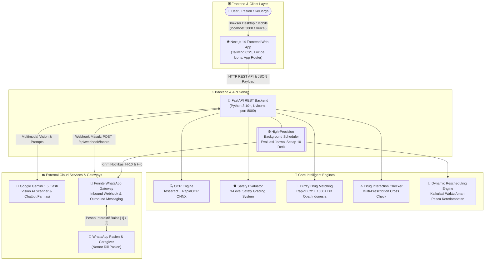
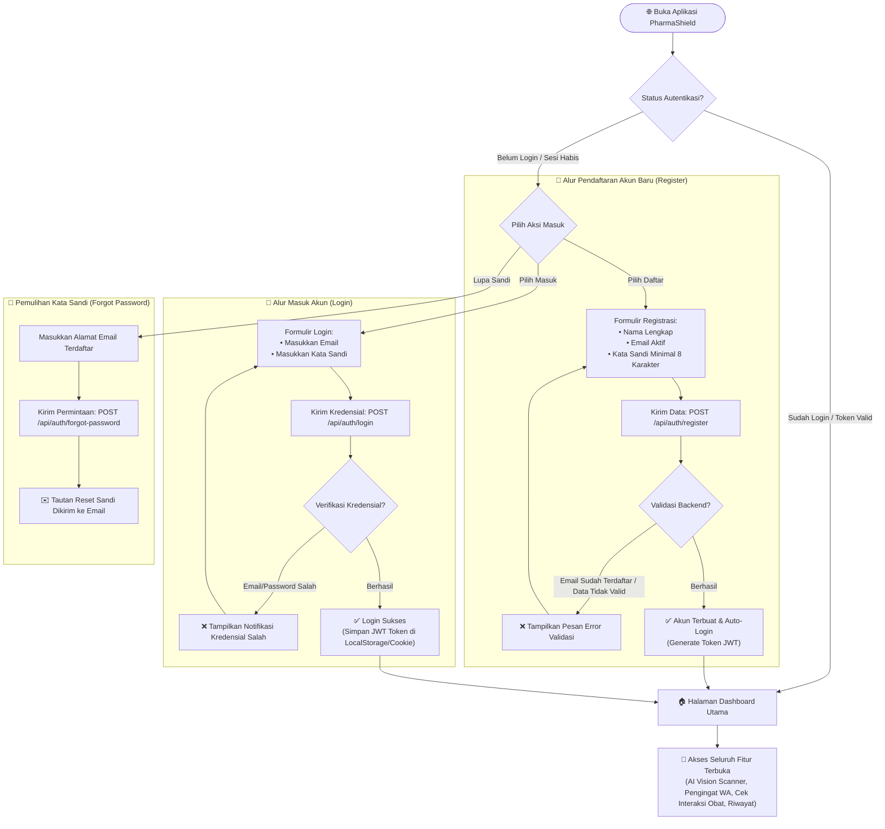
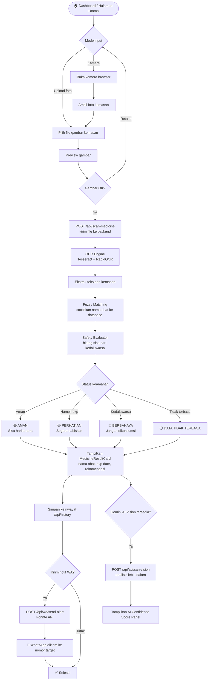
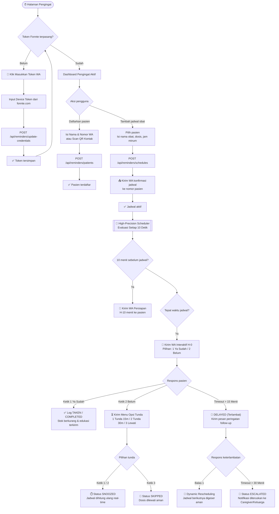
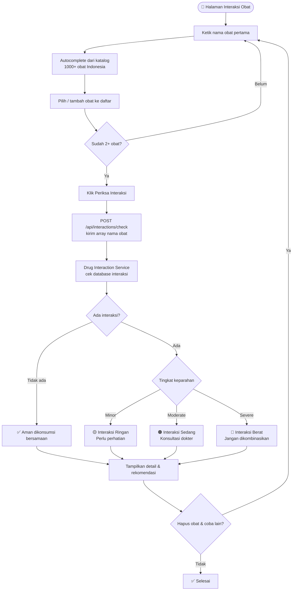
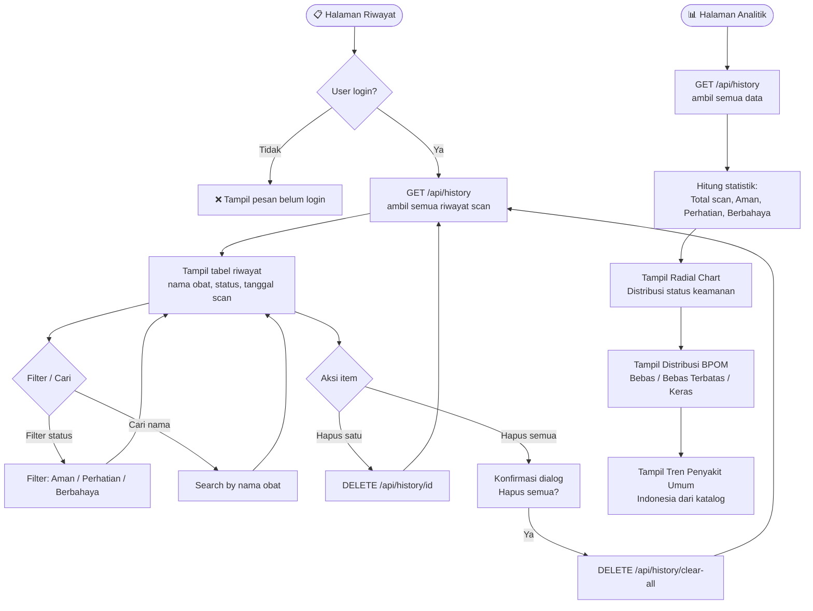
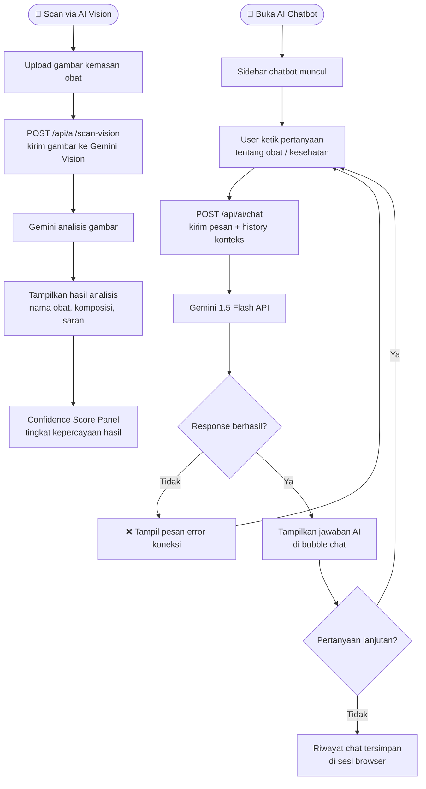
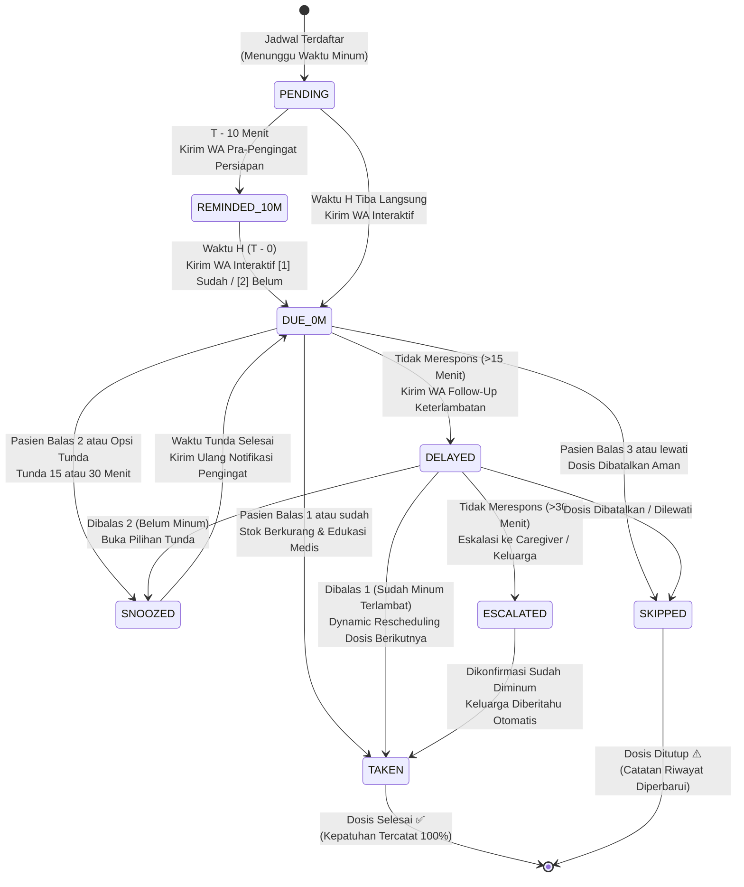

## 👥 Tim Pengembang

### **VectorX**
- **Muhammad Umar Fathullah**
- **Athaillah Ramadhan**
- **Rifqi Aunur Rahman**
- **Rafif Khairi Andriadel**

---

## 🤖 Sumber AI yang Digunakan

### Daftar Sumber AI yang Digunakan dari Gemini:

- https://share.gemini.google/zOKH71ntIyqk
- https://share.gemini.google/75R260X3kKGg
- https://share.gemini.google/hehNQnQPTGdb
- https://share.gemini.google/rjnfcS4rtuX9
- https://share.gemini.google/CxswWaZzA5R8
- https://share.gemini.google/CJGpf3LYLycY
- https://share.gemini.google/FTfN7f5LyiPz

> [!NOTE]  
> **Catatan:** Beberapa prompt juga dijalankan menggunakan platform Antigravity, namun riwayat percakapan tidak dapat diekstrak/diambil.

---

<div align="center">


# 🛡️ MedikaGuard

**Sistem Keamanan & Pengingat Obat Berbasis AI untuk Pasien & Lansia**

[](https://fastapi.tiangolo.com)
[](https://nextjs.org)
[](https://python.org)
[](https://aistudio.google.com)
[](https://fonnte.com)
[](LICENSE)

</div>

---

## 📋 Daftar Isi

- [Tim Pengembang](#-tim-pengembang)
- [Sumber AI yang Digunakan](#-sumber-ai-yang-digunakan)
- [Tentang Project](#-tentang-project)
- [Fitur Utama](#-fitur-utama)
- [Arsitektur Sistem](#-arsitektur-sistem)
- [User Flow](#-user-flow)
  - [Flow 1 — Autentikasi (Login & Register)](#flow-1--autentikasi-login--register)
  - [Flow 2 — Scan Kemasan Obat (AI Scanner)](#flow-2--scan-kemasan-obat-ai-scanner)
  - [Flow 3 — Pengingat Minum Obat (WhatsApp Bot)](#flow-3--pengingat-minum-obat-whatsapp-bot)
  - [Flow 4 — Cek Interaksi Obat](#flow-4--cek-interaksi-obat)
  - [Flow 5 — Riwayat & Analitik](#flow-5--riwayat--analitik)
  - [Flow 6 — AI Chatbot Farmasi](#flow-6--ai-chatbot-farmasi)
  - [State Machine Reminder Engine](#state-machine-reminder-engine)
- [Struktur Project](#-struktur-project)
- [Tech Stack](#-tech-stack)
- [Prasyarat](#-prasyarat)
- [Cara Menjalankan Lokal (Step by Step)](#-cara-menjalankan-lokal-step-by-step)
  - [1. Clone Repository](#1-clone-repository)
  - [2. Setup Backend (FastAPI)](#2-setup-backend-fastapi)
  - [3. Setup Frontend (Next.js)](#3-setup-frontend-nextjs)
  - [4. Jalankan Aplikasi](#4-jalankan-aplikasi)
  - [5. Verifikasi Berjalan](#5-verifikasi-berjalan)
- [Environment Variables Lengkap](#-environment-variables-lengkap)
- [Menjalankan dengan Docker](#-menjalankan-dengan-docker)
- [API Endpoints](#-api-endpoints)
- [WhatsApp Bot & Notifikasi](#-whatsapp-bot--notifikasi)
- [Deployment (Railway + Vercel)](#-deployment-railway--vercel)
- [Testing](#-testing)
- [Troubleshooting](#-troubleshooting)
- [Kontribusi](#-kontribusi)
- [Lisensi](#-lisensi)
- [Link Penting](#-link-penting)

---

## 🎯 Tentang Project

**MedikaGuard** adalah platform kesehatan digital yang dirancang khusus untuk membantu pasien dan keluarga lansia dalam:

1. **📸 Memindai kemasan obat** — AI Vision + OCR mengekstrak nama obat, tanggal kedaluwarsa, dan status keamanan secara otomatis.
2. **⏰ Pengingat minum obat otomatis** — Bot WhatsApp mengirimkan notifikasi ke nomor pasien sesuai jadwal yang didaftarkan, dari nomor bot **+6289520344305**.
3. **🤖 AI Chatbot Farmasi** — Tanya jawab seputar obat-obatan bertenaga Google Gemini.
4. **💊 Katalog Interaksi Obat** — Database interaksi antar obat untuk keselamatan penggunaan.
5. **📊 Riwayat & Analitik** — Histori pemindaian dan statistik penggunaan obat.

---

## ✨ Fitur Utama

| Fitur | Deskripsi |
|-------|-----------|
| 🔍 **AI Vision Scanner** | Scan kemasan obat via foto — ekstrak nama, exp date, status otomatis |
| 📅 **Pengingat Otomatis** | Bot WA kirim notifikasi H-10 menit & tepat waktu minum obat |
| 💬 **Interactive Bot** | Pasien konfirmasi sudah/belum minum via tombol reply WhatsApp |
| 🔄 **Dynamic Rescheduling** | Jadwal otomatis disesuaikan jika pasien terlambat minum |
| 🤖 **AI Chatbot** | Tanya jawab farmasi berbasis Google Gemini AI |
| 💊 **Cek Interaksi Obat** | Deteksi kombinasi obat berpotensi berbahaya |
| 📋 **Katalog Obat** | 1000+ data obat Indonesia dari Alodokter |
| 🔐 **Autentikasi** | Login user dengan JWT token |
| 🌙 **Dark UI** | Antarmuka modern dark-mode |
| 📱 **Responsive** | Optimal di desktop, tablet, dan mobile |

---

## 🏗️ Arsitektur Sistem



---

## 🗺️ User Flow

Berikut adalah diagram alur pengguna untuk setiap fitur utama MedikaGuard, dibuat berdasarkan kode sumber aktual.

---

### Flow 1 — Autentikasi (Login & Register)



---

### Flow 2 — Scan Kemasan Obat (AI Scanner)



---

### Flow 3 — Pengingat Minum Obat (WhatsApp Bot)



---

### Flow 4 — Cek Interaksi Obat



---

### Flow 5 — Riwayat & Analitik



---

### Flow 6 — AI Chatbot Farmasi



---

### State Machine Reminder Engine

Diagram transisi status (*finite state machine*) pada setiap jadwal dosis minum obat pasien di PharmaShield:



#### 📋 Tabel Rincian Transisi & Logika State Machine

| Status | Pemicu (*Trigger*) | Aksi Sistem Otomatis | Tindak Lanjut (*Next State*) |
|---|---|---|---|
| **`PENDING`** | Jadwal obat berhasil didaftarkan | Sistem menjadwalkan timer presisi tinggi di background worker. | Beralih ke `REMINDED_10M` pada H-10 menit atau langsung `DUE_0M`. |
| **`REMINDED_10M`** | Waktu saat ini = Jam Minum - 10 Menit | Mengirimkan pesan WhatsApp pra-pengingat persiapan minum obat. | Menunggu waktu H tepat untuk beralih ke `DUE_0M`. |
| **`DUE_0M`** | Waktu saat ini = Jam Minum Obat (H-0) | Mengirimkan pesan interaktif WhatsApp dengan opsi `[1] Sudah`, `[2] Belum`. | Menunggu balasan pasien (Grace period 15 menit). |
| **`SNOOZED`** | Pasien membalas `2`, `tunda 15m`, atau `tunda 30m` | Menghitung ulang timer jadwal tunda secara real-time. | Mengirimkan notifikasi ulang saat masa tunda selesai (`DUE_0M`). |
| **`DELAYED`** | Pasien belum minum atau tidak ada respons > 15 menit | Mengirimkan pesan WhatsApp follow-up peringatan keterlambatan. | Menunggu konfirmasi lanjutan atau eskalasi ke keluarga. |
| **`ESCALATED`** | Pasien tidak merespons > 30 menit | Mengirimkan notifikasi darurat ke nomor WhatsApp Caregiver/Keluarga terdaftar. | Memastikan pasien tidak melewatkan obat kritis. |
| **`RESCHEDULED`** | Dosis diminum terlambat (setelah follow-up/eskalasi) | Mengaktifkan **Dynamic Rescheduling**: menggeser jadwal dosis berikutnya (`waktu aktual + interval`). | Menghindari risiko akumulasi toksisitas atau overdosis obat. |
| **`TAKEN` / `COMPLETED`** | Pasien membalas `1` / `sudah` | Mengurangi stok obat di inventaris, menghitung persentase kepatuhan mingguan, dan mengirim edukasi medis. | Status dosis ditutup selesai (`[*]`). |
| **`SKIPPED`** | Pasien membalas `3` / `lewati` | Membatalkan dosis saat ini secara aman dengan peringatan medis. | Dosis ditutup tanpa menggeser jadwal reguler berikutnya (`[*]`). |

---

## 📁 Struktur Project

```
pharmashield-project/
│
├── 📂 backend/                        # FastAPI Backend (Python)
│   ├── 📂 app/
│   │   ├── 📂 api/                    # Route Handlers
│   │   │   ├── endpoints.py           # Scan & History endpoints
│   │   │   ├── reminder_endpoints.py  # Reminder CRUD & bot control
│   │   │   ├── ai_endpoints.py        # AI Chatbot endpoints
│   │   │   ├── scan.py                # OCR scan pipeline
│   │   │   └── history.py             # Scan history
│   │   ├── 📂 services/               # Business Logic
│   │   │   ├── wa_service.py          # WhatsApp alert (Fonnte)
│   │   │   ├── meta_wa_service.py     # WhatsApp Cloud API + Fonnte fallback
│   │   │   ├── reminder_service.py    # Patient & schedule engine
│   │   │   ├── scheduler_worker.py    # Background scheduler (30s tick)
│   │   │   ├── ai_service.py          # Gemini AI chatbot
│   │   │   ├── ocr_service.py         # OCR + image preprocessing
│   │   │   ├── safety_evaluator.py    # Expiry & safety check
│   │   │   ├── matching_service.py    # Fuzzy medicine matching
│   │   │   ├── drug_interaction_service.py  # Drug interaction check
│   │   │   ├── auth_service.py        # JWT authentication
│   │   │   └── personalized_safety.py # Personalized safety AI
│   │   ├── config.py                  # Centralized settings (.env loader)
│   │   └── main.py                    # FastAPI app entry + lifespan
│   ├── 📂 data/                       # JSON persistence storage
│   │   ├── scan_history.json          # Riwayat scan
│   │   ├── users.json                 # Data user
│   │   └── reminders_engine.json      # Pasien & jadwal obat
│   ├── 📂 database/                   # Medicines database
│   │   ├── medicines.db               # SQLite
│   │   └── medicines_alodokter_1000.json  # 1000+ obat Indonesia
│   ├── 📂 tests/                      # Unit & Integration tests
│   ├── 📂 uploads/                    # Temporary scan uploads
│   ├── .env                           # ⚠️ Secret! Jangan di-commit
│   ├── requirements.txt               # Python dependencies
│   └── run.py                         # Entry point server
│
├── 📂 frontend/                       # Next.js 14 Frontend
│   ├── 📂 src/
│   │   ├── 📂 app/                    # Next.js App Router pages
│   │   │   ├── page.jsx               # Home — AI Scanner
│   │   │   ├── reminders/page.jsx     # Pengingat Obat & Bot WA
│   │   │   ├── history/page.jsx       # Riwayat Pemindaian
│   │   │   ├── medicines/page.jsx     # Katalog Obat
│   │   │   ├── interactions/page.jsx  # Cek Interaksi Obat
│   │   │   ├── analytics/page.jsx     # Analitik & Statistik
│   │   │   └── settings/page.jsx      # Pengaturan
│   │   ├── 📂 components/             # Reusable React Components
│   │   └── 📂 lib/                    # Utilities & API clients
│   ├── .env.local                     # ⚠️ Secret! Jangan di-commit
│   ├── .env.example                   # Template env variables
│   └── package.json
│
├── Dockerfile                         # Docker build config
├── Procfile                           # Railway / Heroku runner
├── railway.json                       # Railway deployment config
├── vercel.json                        # Vercel API proxy config
└── README.md                          # 📖 File ini
```

---

## 🛠️ Tech Stack

### Backend
| Layer | Teknologi | Versi |
|-------|-----------|-------|
| Web Framework | FastAPI | ≥ 0.110 |
| Language | Python | ≥ 3.10 |
| OCR Engine | Tesseract + RapidOCR (ONNX) | Latest |
| Image Processing | OpenCV Headless + Pillow | Latest |
| AI / Vision | Google Gemini 1.5 Flash | Latest |
| String Matching | RapidFuzz + Levenshtein | Latest |
| HTTP Client | httpx (async) + requests | Latest |
| Auth | JWT (python-jose) + bcrypt | Latest |

### Frontend
| Layer | Teknologi | Versi |
|-------|-----------|-------|
| Framework | Next.js | 14 |
| Language | JavaScript / JSX | ES2022 |
| Styling | Tailwind CSS | 3 |
| Icons | Lucide React | Latest |
| HTTP Client | Axios | Latest |

---

## ✅ Prasyarat

Install semua tools berikut **sebelum** memulai:

### 1. Python ≥ 3.10
```bash
# Cek versi
python --version
# atau
python3 --version
```
Download: https://www.python.org/downloads/

### 2. Node.js ≥ 18
```bash
# Cek versi
node --version
npm --version
```
Download: https://nodejs.org/

### 3. Git
```bash
git --version
```
Download: https://git-scm.com/

### 4. Tesseract OCR
Dibutuhkan untuk fitur scan kemasan obat.

**Windows:**
```bash
winget install UB-Mannheim.TesseractOCR
# Path default: C:\Program Files\Tesseract-OCR\tesseract.exe
```
Atau download installer: https://github.com/UB-Mannheim/tesseract/wiki

**Ubuntu / Debian:**
```bash
sudo apt update
sudo apt install tesseract-ocr tesseract-ocr-ind -y
```

**macOS:**
```bash
brew install tesseract
```

Verifikasi instalasi:
```bash
tesseract --version
```

---

## 🚀 Cara Menjalankan Lokal (Step by Step)

### 1. Clone Repository

```bash
git clone https://github.com/rifqiaunur666/pharmashield-project.git
cd pharmashield-project
```

---

### 2. Setup Backend (FastAPI)

#### 2a. Masuk ke folder backend
```bash
cd backend
```

#### 2b. Buat Virtual Environment

**Windows (PowerShell / CMD):**
```bash
python -m venv venv
venv\Scripts\activate
```

**macOS / Linux:**
```bash
python3 -m venv venv
source venv/bin/activate
```

> Jika berhasil, terminal akan menampilkan prefix `(venv)` di awal baris.

#### 2c. Install Dependencies Python
```bash
pip install --upgrade pip
pip install -r requirements.txt
```

> ⏳ Proses ini membutuhkan waktu 2–5 menit karena menginstall library OCR dan AI.

#### 2d. Buat File `.env` Backend

Buat file baru bernama `.env` di dalam folder `backend/`:

```bash
# Windows
copy NUL .env
# atau buka dengan Notepad / VS Code
notepad .env
```

```bash
# macOS / Linux
touch .env
nano .env
# atau
code .env
```

Isi dengan konfigurasi berikut:

```env
# ─────────────────────────────────────────────────────────────
# WAJIB DIISI untuk fitur WhatsApp Bot
# ─────────────────────────────────────────────────────────────

# Token device WhatsApp dari fonnte.com
# Cara dapat: Daftar di fonnte.com → Sambungkan WA → Salin Device Token
FONNTE_TOKEN=ISI_TOKEN_FONNTE_KAMU_DISINI

# Nomor bot pengirim (nomor WA yang terhubung di Fonnte)
FONNTE_SENDER_NUMBER=6289520344305

# Nomor default penerima alert scan obat (format internasional, tanpa +)
WA_TARGET_NUMBER=6285374497583

# ─────────────────────────────────────────────────────────────
# WAJIB DIISI untuk fitur AI Scanner & Chatbot
# ─────────────────────────────────────────────────────────────

# API Key Google Gemini AI (GRATIS)
# Cara dapat: https://aistudio.google.com/app/apikey → klik "Get API Key"
GEMINI_API_KEY=ISI_API_KEY_GEMINI_KAMU_DISINI

# ─────────────────────────────────────────────────────────────
# Konfigurasi Server (bisa dibiarkan default)
# ─────────────────────────────────────────────────────────────
APP_ENV=development
PORT=8000
CORS_ORIGINS=http://localhost:3000,http://127.0.0.1:3000

# Path Tesseract OCR (sesuaikan jika berbeda)
# Windows default:
TESSERACT_CMD=C:\Program Files\Tesseract-OCR\tesseract.exe
# Linux/macOS:
# TESSERACT_CMD=/usr/bin/tesseract
```

---

### 3. Setup Frontend (Next.js)

Buka **terminal baru** (jangan tutup terminal backend), lalu:

#### 3a. Masuk ke folder frontend
```bash
# Dari root project
cd frontend
```

#### 3b. Install Dependencies Node.js
```bash
npm install
```

> ⏳ Proses ini membutuhkan waktu 1–3 menit.

#### 3c. Buat File `.env.local` Frontend

```bash
# Windows
copy NUL .env.local
notepad .env.local
```

```bash
# macOS / Linux
touch .env.local
nano .env.local
```

Isi dengan:

```env
# URL backend FastAPI (jangan ada trailing slash)
NEXT_PUBLIC_API_URL=http://127.0.0.1:8000
```

---

### 4. Jalankan Aplikasi

Kamu membutuhkan **2 terminal** yang berjalan bersamaan.

#### Terminal 1 — Jalankan Backend

```bash
# Pastikan sudah di folder backend dan venv aktif
cd backend

# Windows:
venv\Scripts\activate
# macOS/Linux:
source venv/bin/activate

# Jalankan server development (dengan auto-reload)
uvicorn app.main:app --reload --host 127.0.0.1 --port 8000
```

Output yang diharapkan:
```
INFO:     Started server process [xxxx]
INFO:     Waiting for application startup.
INFO:     [SchedulerWorker] High-precision background reminder worker started.
INFO:     Application startup complete.
INFO:     Uvicorn running on http://127.0.0.1:8000 (Press CTRL+C to quit)
```

#### Terminal 2 — Jalankan Frontend

```bash
# Pastikan sudah di folder frontend
cd frontend

# Jalankan development server
npm run dev
```

Output yang diharapkan:
```
  ▲ Next.js 14.x.x
  - Local:        http://localhost:3000
  - Network:      http://192.168.x.x:3000

✓ Ready in 2.5s
```

---

### 5. Verifikasi Berjalan

Buka browser dan akses URL berikut:

| URL | Keterangan |
|-----|-----------|
| http://localhost:3000 | ✅ Aplikasi MedikaGuard (Frontend) |
| http://localhost:8000 | ✅ Backend API Health Check |
| http://localhost:8000/docs | ✅ Swagger UI — Dokumentasi API Interaktif |
| http://localhost:8000/redoc | ✅ ReDoc — Dokumentasi API Alternatif |

**Test API secara manual:**
```bash
# Cek health backend
curl http://localhost:8000/health

# Response yang diharapkan:
# {"status":"ok","service":"MedikaGuard API","version":"2.0.0",...}
```

---

## 🔧 Environment Variables Lengkap

### Backend (`backend/.env`)

| Variable | Wajib | Default | Keterangan |
|----------|-------|---------|-----------|
| `FONNTE_TOKEN` | ✅ Ya | — | Device token dari [fonnte.com](https://fonnte.com) |
| `FONNTE_SENDER_NUMBER` | — | `6289520344305` | Nomor bot pengirim WA |
| `WA_TARGET_NUMBER` | — | — | Nomor default penerima alert scan |
| `GEMINI_API_KEY` | ✅ Ya | — | API Key dari [Google AI Studio](https://aistudio.google.com/app/apikey) |
| `APP_ENV` | — | `development` | `development` / `production` |
| `PORT` | — | `8000` | Port server backend |
| `CORS_ORIGINS` | — | `http://localhost:3000,...` | Origin yang diizinkan (pisah koma) |
| `TESSERACT_CMD` | — | Auto-detect | Path ke binary Tesseract |

### Frontend (`frontend/.env.local`)

| Variable | Wajib | Default | Keterangan |
|----------|-------|---------|-----------|
| `NEXT_PUBLIC_API_URL` | ✅ Ya | `http://127.0.0.1:8000` | URL backend FastAPI |

---

## 🐳 Menjalankan dengan Docker

Alternatif jika tidak ingin setup manual (membutuhkan [Docker Desktop](https://www.docker.com/products/docker-desktop/)):

### Build & Jalankan Backend saja

```bash
# Dari root project
docker build -t pharmashield-backend .

# Jalankan dengan env variables
docker run -p 8000:8000 \
  -e FONNTE_TOKEN=token_kamu \
  -e GEMINI_API_KEY=key_kamu \
  -e APP_ENV=development \
  pharmashield-backend
```

### Menggunakan Docker Compose (Backend + Frontend)

```bash
# Dari root project
docker compose up --build

# Atau jalankan di background
docker compose up -d --build

# Stop
docker compose down
```

Akses aplikasi di http://localhost:3000

---

## 🌐 API Endpoints

### 📸 Scan & Medicine

| Method | Endpoint | Deskripsi |
|--------|----------|-----------|
| `POST` | `/api/scan-medicine` | Upload foto kemasan obat untuk dianalisis |
| `GET` | `/api/history` | Ambil riwayat pemindaian |
| `DELETE` | `/api/history/{id}` | Hapus item riwayat |
| `GET` | `/api/stats` | Statistik penggunaan |

### ⏰ Reminder & WhatsApp Bot

| Method | Endpoint | Deskripsi |
|--------|----------|-----------|
| `GET` | `/api/reminders/patients` | Daftar semua pasien |
| `POST` | `/api/reminders/patients` | Daftarkan pasien baru |
| `DELETE` | `/api/reminders/patients/{id}` | Hapus pasien |
| `POST` | `/api/reminders/schedules` | Tambah jadwal minum obat |
| `GET` | `/api/reminders/schedules` | Daftar jadwal aktif |
| `DELETE` | `/api/reminders/schedules/{id}` | Hapus jadwal |
| `POST` | `/api/reminders/simulate-tick` | Simulasi trigger scheduler |
| `GET` | `/api/reminders/gateway-status` | Status koneksi bot WA |
| `POST` | `/api/reminders/update-credentials` | Update token gateway |
| `GET` | `/api/reminders/logs` | Riwayat pengiriman notifikasi |

### 🤖 AI Chatbot

| Method | Endpoint | Deskripsi |
|--------|----------|-----------|
| `POST` | `/api/ai/chat` | Chat dengan AI farmasi (Gemini) |
| `POST` | `/api/ai/scan-vision` | Analisis gambar via Gemini Vision |
| `GET` | `/api/ai/status` | Status koneksi Gemini AI |

### 🔐 Autentikasi

| Method | Endpoint | Deskripsi |
|--------|----------|-----------|
| `POST` | `/api/auth/register` | Register akun baru |
| `POST` | `/api/auth/login` | Login & dapatkan JWT token |
| `GET` | `/api/auth/me` | Info user yang sedang login |

> 💡 Dokumentasi API interaktif lengkap tersedia di **http://localhost:8000/docs** saat backend berjalan.

---

## 📱 WhatsApp Bot & Notifikasi

MedikaGuard menggunakan **[Fonnte](https://fonnte.com)** sebagai gateway WhatsApp.

### Cara Kerja Otomatis

```
Scheduler berjalan setiap 30 detik
         ↓
Cek semua jadwal minum obat terdaftar
         ↓
H-10 menit sebelum jadwal
→ Kirim pesan persiapan ke pasien
         ↓
Tepat waktu jadwal (H-0)
→ Kirim pesan + tombol [Ya, Sudah Minum] / [Belum]
         ↓
Jika pasien membalas [Belum]
→ Kirim follow-up reminder 10 menit kemudian
         ↓
Jika pasien membalas [Ya, Sudah] / melewati batas waktu
→ Dynamic rescheduling: jadwal berikutnya disesuaikan otomatis
```

### Cara Setup Token Fonnte

1. Daftar di **[fonnte.com](https://fonnte.com)**
2. Klik **"Tambah Device"** → sambungkan nomor WhatsApp dengan scan QR
3. Salin **Device Token** dari dashboard Fonnte
4. Di aplikasi MedikaGuard → halaman **Pengingat** → klik **"🔑 Masukkan Token WhatsApp"**
5. Paste token → Simpan

> **Bot Pengirim:** `+6289520344305` — Semua notifikasi dikirim dari nomor ini.

---

## ☁️ Deployment (Railway + Vercel)

### Backend → Railway

1. Buat akun di [railway.app](https://railway.app)
2. Klik **"New Project"** → **"Deploy from GitHub Repo"**
3. Pilih repo `pharmashield-project`
4. Di tab **"Variables"**, tambahkan semua env dari `backend/.env`:
   ```
   FONNTE_TOKEN=...
   GEMINI_API_KEY=...
   APP_ENV=production
   PORT=8080
   ```
5. Railway akan otomatis build & deploy menggunakan `Dockerfile` dan `Procfile`
6. Salin URL Railway yang diberikan (format: `https://xxx.up.railway.app`)

### Frontend → Vercel

1. Buat akun di [vercel.com](https://vercel.com)
2. Klik **"Add New Project"** → import dari GitHub
3. Set **Root Directory** → `frontend`
4. Di tab **"Environment Variables"**, tambahkan:
   ```
   NEXT_PUBLIC_API_URL=https://URL_RAILWAY_KAMU.up.railway.app
   ```
5. Klik **Deploy**

### Update URL Railway di Kode

Setelah dapat URL Railway, update file `frontend/next.config.js`:

```js
// Ganti baris ini:
destination: 'https://pharmashield-project-production.up.railway.app/api/:path*'
// Dengan URL Railway kamu:
destination: 'https://URL_RAILWAY_KAMU.up.railway.app/api/:path*'
```

---

## 🧪 Testing

```bash
# Masuk ke folder backend
cd backend

# Aktifkan virtual environment
# Windows:
venv\Scripts\activate
# macOS/Linux:
source venv/bin/activate

# Jalankan semua test
pytest tests/ -v

# Jalankan test tertentu
pytest tests/test_reminder_engine.py -v
pytest tests/test_pharmashield.py -v

# Jalankan dengan coverage report
pytest tests/ -v --tb=short
```

---

## 🔧 Troubleshooting

### ❌ `ModuleNotFoundError: No module named 'app'`
```bash
# Pastikan menjalankan dari folder backend, bukan root project
cd backend
uvicorn app.main:app --reload --port 8000
```

### ❌ `TesseractNotFoundError`
```bash
# Windows: Tambahkan path Tesseract ke .env
TESSERACT_CMD=C:\Program Files\Tesseract-OCR\tesseract.exe

# Linux/macOS: Cek path instalasi
which tesseract
# Lalu set di .env:
TESSERACT_CMD=/usr/bin/tesseract
```

### ❌ `CORS Error` di browser
```bash
# Pastikan CORS_ORIGINS di backend/.env mencakup URL frontend kamu
CORS_ORIGINS=http://localhost:3000,http://127.0.0.1:3000
```

### ❌ WhatsApp bot tidak mengirim pesan
- Pastikan `FONNTE_TOKEN` sudah diisi dengan **Device Token** (bukan Account Token)
- Cek status device di dashboard Fonnte — harus **Connected**
- Pastikan nomor target dalam format internasional: `628xxxxxxxxx` (tanpa `+`)

### ❌ AI Chatbot / Scanner tidak bekerja
- Pastikan `GEMINI_API_KEY` sudah diisi dengan benar
- Cek kuota API di [Google AI Studio](https://aistudio.google.com)
- Tier gratis: 60 request/menit, 1.500 request/hari

### ❌ `npm install` gagal
```bash
# Hapus node_modules dan install ulang
cd frontend
rm -rf node_modules package-lock.json
npm install
```

### ❌ Port 8000 sudah digunakan
```bash
# Ganti port di backend/.env
PORT=8001

# Jalankan dengan port baru
uvicorn app.main:app --reload --port 8001

# Update frontend/.env.local
NEXT_PUBLIC_API_URL=http://127.0.0.1:8001
```

---

## 🤝 Kontribusi

Kami sangat menyambut kontribusi! Berikut panduan untuk kolaborator:

### Alur Kerja Git

```
main                    ← Branch production, selalu stabil
  └── develop           ← Branch development utama (opsional)
        ├── feature/xxx ← Fitur baru
        ├── fix/xxx     ← Bug fix
        └── docs/xxx    ← Update dokumentasi
```

### Langkah Kontribusi

1. **Fork** repository ini di GitHub

2. **Clone** fork kamu:
   ```bash
   git clone https://github.com/USERNAME_KAMU/pharmashield-project.git
   cd pharmashield-project
   ```

3. **Buat branch** baru:
   ```bash
   git checkout -b feature/nama-fitur-kamu
   # Contoh:
   git checkout -b feature/multi-dosis-reminder
   git checkout -b fix/parser-tanggal-kedaluwarsa
   ```

4. **Kerjakan perubahan**, lalu commit:
   ```bash
   git add .
   git commit -m "feat: tambah fitur pengingat multi-dosis"
   ```

5. **Push** branch ke GitHub:
   ```bash
   git push origin feature/nama-fitur-kamu
   ```

6. **Buat Pull Request** di GitHub → pilih base branch `main`

### Konvensi Commit Message

Format: `<type>: <deskripsi singkat>`

| Type | Kapan digunakan |
|------|----------------|
| `feat:` | Menambah fitur baru |
| `fix:` | Memperbaiki bug |
| `docs:` | Mengubah dokumentasi |
| `style:` | Perubahan tampilan / CSS |
| `refactor:` | Refactoring kode (tanpa ubah fitur) |
| `test:` | Menambah atau mengubah test |
| `chore:` | Update dependency, config, dll |

Contoh:
```
feat: tambah notifikasi WhatsApp multi-bahasa
fix: perbaiki parsing tanggal exp format MM/YYYY
docs: tambah panduan setup Docker di README
refactor: pisah reminder engine menjadi modul terpisah
```

### Aturan Coding

- **Python**: Ikuti PEP 8, gunakan type hints untuk semua fungsi
- **JavaScript/JSX**: Gunakan functional components & React Hooks
- **Komentar**: Bahasa Indonesia untuk komentar bisnis logic
- **Jangan commit**: `.env`, `node_modules/`, `venv/`, `.venv/`, `__pycache__/`, `uploads/*`

---

## 📄 Lisensi

Project ini menggunakan lisensi **MIT** — bebas digunakan, dimodifikasi, dan didistribusikan dengan menyertakan kredit.

---

## 🔗 Link Penting

| Resource | URL |
|----------|-----|
| 🌐 Demo Live | _Coming soon_ |
| 📚 API Docs | http://localhost:8000/docs |
| 🐙 GitHub Repo | https://github.com/rifqiaunur666/pharmashield-project |
| 🤖 Fonnte Dashboard | https://fonnte.com |
| 🧠 Gemini AI Studio | https://aistudio.google.com |
| 🚂 Railway | https://railway.app |
| ▲ Vercel | https://vercel.com |
| 🔤 Tesseract OCR | https://github.com/UB-Mannheim/tesseract/wiki |

---

<div align="center">

Dibuat dengan ❤️ untuk membantu lansia & keluarga Indonesia 🇮🇩

**MedikaGuard — Obat Aman, Keluarga Sehat**

⭐ Jika project ini bermanfaat, jangan lupa beri **Star** di GitHub!

</div>
